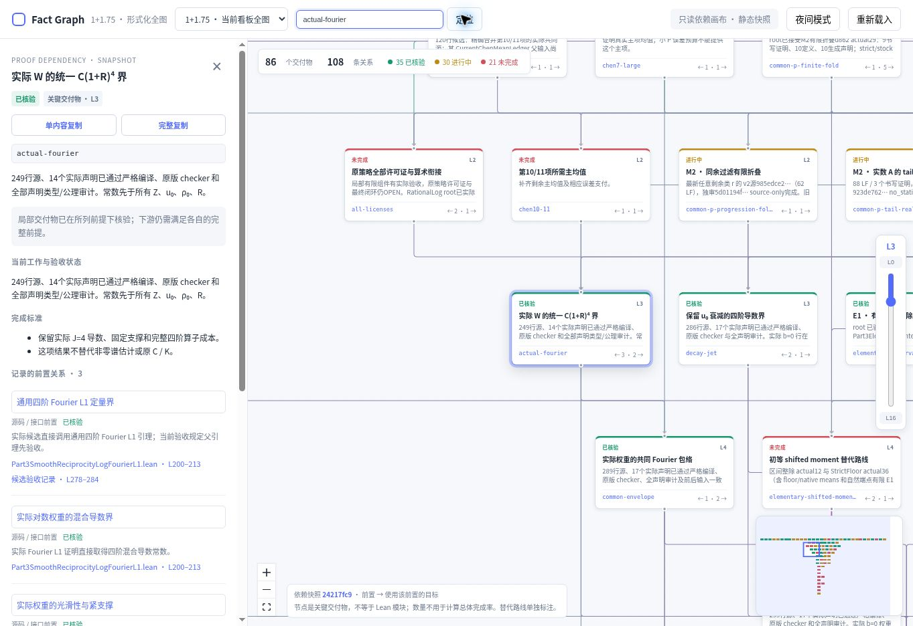

# Fact Graph Pages

静态数学事实与证明依赖查看器。新增 **[RH / Dirichlet GRH 证明图谱](https://uynewnas.github.io/fact-graph-page/?graph=riemann)**；顶部菜单也可选择 1+1.75 形式化图和 Danus 事实图谱。未指定参数时仍默认打开 Goldbach。开发和生产环境都读取仓库里的静态数据，不需要 Node API、数据库或运行时服务。

## 黎曼证明图谱 · 2026-11-23

证明归属 **Levent Alpöge，与 Claude 合作**；本项目制作可追溯的阅读图与源码索引。依据 [CocoSgt 的公开镜像](https://github.com/CocoSgt/riemann-hypothesis-lean/tree/7cbf7a0c32fca1badf05931879a37c3f8a2b03b4)，固定提交 `7cbf7a0c32fca1badf05931879a37c3f8a2b03b4`。原公告见 [alpo.ge/remark.pdf](https://alpo.ge/remark.pdf)。

### 两层阅读方式

| 层次 | 本次覆盖 | 关系含义 |
| --- | --- | --- |
| 中文证明图 | 34 个主线节点 + 8 个审查入口，38 条关系 | 人工对照源码定位的直接引用，或明确标记的命题接口 |
| 完整源码模块索引 | 175,187 个 Lean 模块，17,374,215 行 | 显式 `import`；753,261 条项目内部关系、136,503 条外部关系 |

主线覆盖 `Main.lean` 的五个根定理、`EveryCharacter` 的组装、窗口无零点判据、Galois / theta 输入，以及函数方程归约。每个节点展示中文命题、推导说明、完整 Lean 名称、固定提交源码行和证据。`kform_unfold`、Poincaré 内积、`InHH`、Perron 和 theta 唯一性等列为延伸审查入口，没有根据导入关系把它们强行接成根定理的直接证明依赖。

点击 **全库模块** 可搜索整个源码目录，包括 `src/Main.lean` 形式的路径；查看固定版本源码、SHA-256、直接导入及直接使用者。邻域两侧各显示最多 10 个模块，下面的关系列表按 50 项分页，可以访问全部关系。索引只在打开浏览器时加载，分块按需读取。

完整源码索引去掉 20,058 次重复显式导入；348 个外部模块只登记、不递归展开。模块图无环，`Main` 沿导入可到达全部 175,187 个项目模块。**这个全库覆盖是模块导入覆盖；42 节点图是阅读主线，不是全部声明的逐项证明展开。模块导入也不等同最终定理的证明项依赖闭包。**

### 来源与核验范围

根结论为 RH 与 **Dirichlet L 函数的 GRH**，不扩大为一般 Hecke / Dedekind / 自守 L 函数的 GRH。非零模数、主特征在 `s=1` 的排除条件、窗口参数等按各节点声明保留。

节点的蓝色“源码可追溯”表示本次查到了声明和引用位置。本次没有运行 Lean 编译或内核验证；页面链接并记录独立报告的日期、检查项目和范围：

- [Michael Rubinstein / Waterloo](https://mrubinst.github.io/grh-lean-verification/)：报告全库编译、五个根定理的公理审计、Lean 模块回放与 nanoda 检查通过。
- [Andrew Sutherland / MIT](https://math.mit.edu/~drew/grh/)：报告独立重建及多个内核检查；截至页面所载 2026-11-22 16:20 UTC，导出上的 Lean 内核检查和端到端 Comparator 的内核阶段仍列为运行中。

两份报告与镜像 README 记载同一原始归档 SHA-256 `9631b4f020199e580ba86178cb56c6e9b09f690c2369a80dc4334aa93f49c7fc`。本次已核对镜像固定提交的所有源码 Git blob，但没有把镜像整树与原作者 14 个分卷独立逐文件比较。对报告的适用版本保留这个区别。

[Rubinstein 主站链接的解释稿](https://www.math.uwaterloo.ca/~mrubinst/alpoge_claude_grh/)是辅助读物，其主不等式 (M) 引用 Lean development 的证明；这里没有把解释稿视为独立补齐 (M) 的证明。镜像未声明原代码许可证，本仓库使用自行撰写的说明、声明名称、文件元数据和引用，不再分发整套 Lean 源码。

### 数据与可复现提取

| 文件 | 内容 |
| --- | --- |
| `public/riemann-graph.json` | 主线、审查入口、逐边证据、声明位置、第三方核验记录 |
| `public/riemann-modules/manifest.json` | 覆盖率、版本、分组统计、源码聚合哈希及每个分发文件的哈希 |
| `public/riemann-modules/names.json.gz` | 全量模块名称与稳定数字 ID |
| `public/riemann-modules/chunks/*.json.gz` | 343 个分块中的直接导入、反向关系、行号和文件哈希 |
| `scripts/extract-riemann-modules.py` | 固定版本、完整目录与 Git blob 核对；嵌套注释和多行 import 解析 |
| `scripts/test-riemann-extractor.py` | 16 项回归测试，以及独立的全库源码／索引比对 |
| `scripts/compress-riemann-index.mjs` | 无损 gzip 分发与压缩前后哈希记录 |

原始索引数据为 54,686,272 bytes，压缩后为 13,026,474 bytes。`names` 首次传输约 1.49 MB，浏览器用 `DecompressionStream` 解压；需要支持该 API 的现代浏览器。数据格式仍是 JSON。源码聚合 SHA-256 为 `8b184b4fd12af28e18e1e6d7c66b2a1c3cd176fdac38a1a766cd3276f2e25071`，具体聚合规则见 manifest。

先自行取出上述固定提交，设 `RH_SOURCE` 为它的工作目录。以下均为源码扫描，不启动 Lean：

```bash
python3 scripts/test-riemann-extractor.py
python3 scripts/extract-riemann-modules.py --source-dir "$RH_SOURCE" --output-dir public/riemann-modules
# 独立 Python 全库审查读取未压缩 JSON，必须在下一步压缩之前运行。
python3 scripts/test-riemann-extractor.py --index public/riemann-modules --source-dir "$RH_SOURCE"
node scripts/compress-riemann-index.mjs
# Node 校验读取发布用 gzip 文件，并检查压缩前后哈希、全部关系和 Main 覆盖。
RIEMANN_SOURCE_ROOT="$RH_SOURCE" npm run check:graph
npm run build
```

普通部署无需取出上游源码；`npm run check:graph` 直接校验已提交的快照。需要换源码版本时，应同时更新策展节点、固定提交证据、提取脚本的版本参数及相应快照断言。

## 当前完整证明图

从[形式化项目看板](https://goldbach-proof-tree-oct21-timot.famous-pine-1741.chatgpt.site)导出，包含 **86 个交付物、108 条关系**：35 项已核验、30 项进行中、21 项未完成。

| 文件 | 内容 |
| --- | --- |
| `public/goldbach-graph.json` | 看板 `dist/dependencies.json` 的逐字节副本，保留所有节点、连线、状态、证据、targets 和 frontier |
| `public/goldbach-details.json` | 图中 73 个节点对应的完成标准和补充证据链接；附原文件 SHA-256 和快照来源 |
| `public/fact-graph.json` | 原 Danus 快照，继续通过数据集菜单提供 |

依赖快照的源码版本为 [`24217fc9b7c385689c992c4ea8c2d1f6026db3db`](https://github.com/UyNewNas/goldbach-formalization/commit/24217fc9b7c385689c992c4ea8c2d1f6026db3db)，核对时间为北京时间 **2026-10-22 10:01**。补充详情来自北京时间 **2026-10-23 14:06** 的任务树快照；它没有扩充或替换依赖图的节点集合。

图谱支持缩放、平移、缩略图、层级定位、节点名称 / ID / 模块路径搜索，以及详情、证据链接和关联节点跳转。可以用 `?graph=goldbach` 或 `?graph=danus` 指定初始数据集。



### 状态与关系含义

- 绿色只表示该局部交付物在所列前提下已核验；黄色、红色不会显示为已证明。交付物数量不等于 Lean 模块数量，也不用于重新计算总体完成率。
- 箭头从前置指向使用它的目标，保留源码 / 接口、当前路线、最终验收、已核验组件及替代路线五种关系。
- 紫色虚线表示**替代路线**，不把它解释为必须同时满足的前置条件。
- `dependencySemantics` 与 `directImport: false` 等原始元数据保留在快照和节点完整复制内容中；源码闭合验收前置不等于直接 import 或新增数学假设。
- 该导出是项目依赖与验收状态快照。节点详情展示已有说明、完成标准和证据，不生成新的数学证明。

## 本地查看

```bash
npm ci
npm run check:graph
npm run dev
```

生产构建：`npm run build`。推送到 `main` 后，GitHub Actions 依次验证图谱、构建并部署 Pages。

`check:graph` 校验当前导出的字节哈希、86 / 108 全量计数、三种核验状态、节点与连线元数据、替代路线、传递验收前置、详情补充以及原 Danus 图谱兼容性。更新证明图快照时应同步更新详情来源与这些快照断言。

## 更新原 Danus 图谱快照

该仓库只保存可审计的静态快照。需要在原始 Danus 工作区执行：

```bash
cd fact-graph-viewer/dify-ui
npm run snapshot
```

随后提交 `public/fact-graph.json` 并推送到 `main`；GitHub Actions 会自动构建并部署 Pages。

`fact-graph.json` 包含完整事实陈述、证明与术语，因此公开 Pages 会公开这些内容。部署前请确认仓库与 Pages 可见性符合预期。
