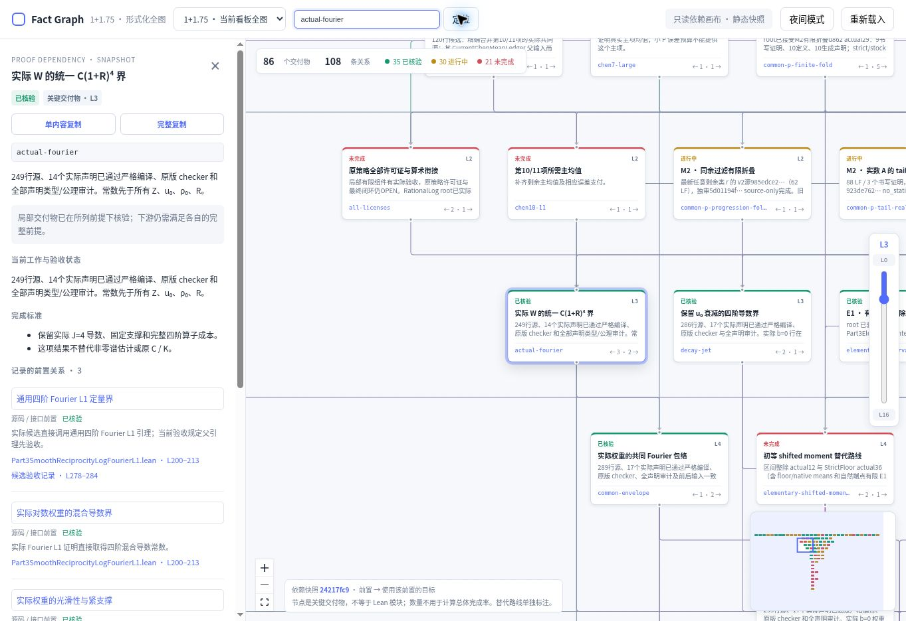

# Fact Graph Pages

静态 GitHub Pages 查看器，默认打开 **1+1.75 形式化完整依赖图**；顶部数据集菜单可以切回原有的 Danus 事实图谱。开发和生产环境都读取仓库里的静态 JSON，不需要 Node API、数据库或运行时服务。

## 当前完整证明图

从[形式化项目看板](https://goldbach-proof-tree-oct21-timot.famous-pine-1741.chatgpt.site)导出，包含 **86 个交付物、108 条关系**：35 项已核验、30 项进行中、21 项未完成。

| 文件 | 内容 |
| --- | --- |
| `public/goldbach-graph.json` | 看板 `dist/dependencies.json` 的逐字节副本，保留所有节点、连线、状态、证据、targets 和 frontier |
| `public/goldbach-details.json` | 图中 73 个节点对应的完成标准和补充证据链接；附原文件 SHA-256 和快照来源 |
| `public/fact-graph.json` | 原 Danus 快照，继续通过数据集菜单提供 |

依赖快照的源码版本为 [`24217fc9b7c385689c992c4ea8c2d1f6026db3db`](https://github.com/UyNewNas/goldbach-formalization/commit/24217fc9b7c385689c992c4ea8c2d1f6026db3db)，核对时间为北京时间 **2026-10-22 10:01**。补充详情来自北京时间 **2026-10-23 14:06** 的任务树快照；它没有扩充或替换依赖图的节点集合。

图谱支持缩放、平移、缩略图、层级定位、节点名称 / ID / 模块路径搜索，以及详情、证据链接和关联节点跳转。可以用 `?graph=goldbach` 或 `?graph=danus` 指定初始数据集。



### 状态与关系含义

- 绿色只表示该局部交付物在所列前提下已核验；黄色、红色不会显示为已证明。交付物数量不等于 Lean 模块数量，也不用于重新计算总体完成率。
- 箭头从前置指向使用它的目标，保留源码 / 接口、当前路线、最终验收、已核验组件及替代路线五种关系。
- 紫色虚线表示**替代路线**，不把它解释为必须同时满足的前置条件。
- `dependencySemantics` 与 `directImport: false` 等原始元数据保留在快照和节点完整复制内容中；源码闭合验收前置不等于直接 import 或新增数学假设。
- 该导出是项目依赖与验收状态快照。节点详情展示已有说明、完成标准和证据，不生成新的数学证明。

## 本地查看

```bash
npm ci
npm run check:graph
npm run dev
```

生产构建：`npm run build`。推送到 `main` 后，GitHub Actions 依次验证图谱、构建并部署 Pages。

`check:graph` 校验当前导出的字节哈希、86 / 108 全量计数、三种核验状态、节点与连线元数据、替代路线、传递验收前置、详情补充以及原 Danus 图谱兼容性。更新证明图快照时应同步更新详情来源与这些快照断言。

## 更新原 Danus 图谱快照

该仓库只保存可审计的静态快照。需要在原始 Danus 工作区执行：

```bash
cd fact-graph-viewer/dify-ui
npm run snapshot
```

随后提交 `public/fact-graph.json` 并推送到 `main`；GitHub Actions 会自动构建并部署 Pages。

`fact-graph.json` 包含完整事实陈述、证明与术语，因此公开 Pages 会公开这些内容。部署前请确认仓库与 Pages 可见性符合预期。
